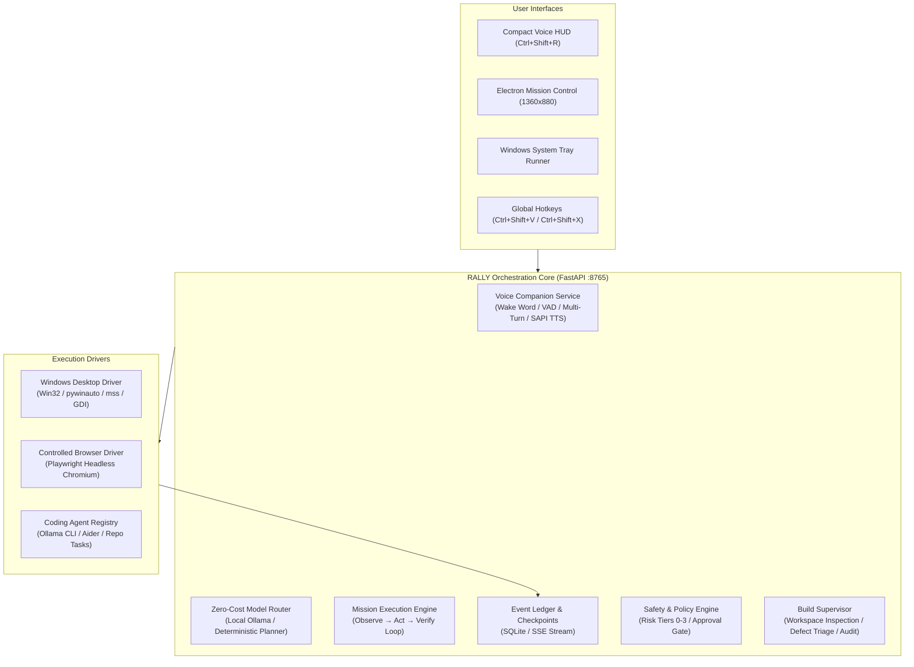

# RALLY 2.0 — Autonomous Local AI Desktop Operator & Build Supervisor

> **RALLY 2.0** is a local-first, zero-cost autonomous AI desktop companion and software build supervisor. It combines always-on conversational voice activation ("Hey RALLY"), multi-turn intent routing, native Windows UI automation, Playwright web execution, and an evidence-backed build supervisor into a cohesive desktop platform.

---

## 🏛️ System Architecture



---

## 🚀 Key Capabilities

### 1. Always-On Voice Companion ("Hey RALLY")
- **Wake Word Recognition**: Listens for `"Hey RALLY"` (or customizable phrase) with adaptive noise calibration.
- **Multi-Turn Conversational Memory**: 22-second follow-up window allowing natural chained instructions without repeating the wake word.
- **Natural SAPI Text-to-Speech**: Integrated Windows Speech Synthesis with volume control and conversational responses.
- **Windows Startup Persistence**: Automatically register or unregister with the Windows `HKCU\Software\Microsoft\Windows\CurrentVersion\Run` registry.
- **Global Hotkeys**:
  - `Ctrl + Shift + V`: Instant voice capture from any application.
  - `Ctrl + Shift + R`: Toggle the floating Always-On HUD Companion.
  - `Ctrl + Shift + X`: **Emergency Stop** — immediately halts active missions and kills spawned tasks.

### 2. Zero-Cost Policy & Model Router
- **Strict Zero-Cost Enforcement**: Rejects paid APIs when running in `zero_cost_only` mode (`RALLY_SPEND_MODE=zero_cost_only`).
- **Deterministic Local Planner**: Built-in instantaneous local task decomposition engine capable of structuring complex desktop and browser missions without API bills.
- **Local Model Daemon Integration**: Seamless hook into Ollama (`qwen2.5-coder:3b`, `llama3.2`, etc.).

### 3. Native Windows Desktop Operator
- **Win32 Interactive Station Attachment**: Ensures background worker threads attach to the interactive `Default` desktop station, enabling rock-solid `BitBlt` capture and window discovery across all Windows 10 & 11 builds.
- **Application Lifecycle Control**: Launch, activate, and bring to foreground any installed application via executable paths, URI protocols (`spotify:`, `ms-settings:`), or Windows Start Menu (`Get-StartApps`).
- **Visual Evidence Recording**: Multi-layer screenshot pipeline (`mss` &rarr; `PIL.ImageGrab` &rarr; verified bitmap) that records visual proof of execution for every action.
- **Artifact Server API**: Full HTTP file server endpoint (`/api/v1/evidence/{id}/artifact`) allowing immediate inspection and download of high-resolution mission evidence screenshots.

### 4. Controlled Browser Automation
- **Playwright Headless Chromium**: Automates browser navigation, DOM inspection, console error capture, and network inspection.
- **Prompt Injection Defense**: Real-time DOM scanning against malicious prompt injection tokens (`detect_prompt_injection`).
- **Isolated Draft Composer**: Drafts emails and messages in a sandbox without transmitting until explicit authorization.

### 5. Autonomous Build Supervisor
- **Workspace Quality Gate**: Scans projects for framework type, file count, and git status.
- **Automated Verification Checks**: Executes test suites (`pytest`), compilation runs, and linters with process isolation and secret redaction.
- **Defect Triage & Prompt Dispatch**: Automatically generates structured defect records with repro logs and writes corrective instructions (`.rally_corrective_task.md`) for coding agents.
- **Truthful Audit Reporting**: Generates tamper-evident verification reports documenting exact passed checks, evidence IDs, and unresolved defects.

### 6. Tiered Consequential Action Governance
- **Risk Tier Classification**:
  - **Tier 0**: Read-only observation (`read_ui_tree`, `capture_screenshot`).
  - **Tier 1**: Reversible workspace and desktop actions (`launch_app`, `open_url`).
  - **Tier 2**: External side effects & communications (`send_external_message`, destructive commands).
  - **Tier 3**: Admin / system modifications.
- **Approval Gate**: Tier 2+ actions automatically pause execution in `AWAITING_APPROVAL` status until explicitly approved by the user via the dashboard or API.

---

## ⌨️ Global Keyboard Shortcuts

| Shortcut | Description | Target Window |
|---|---|---|
| <kbd>Ctrl</kbd> + <kbd>Shift</kbd> + <kbd>Space</kbd> | **Wake RALLY Live** (Pop up HUD & start voice listening) | Global (Any App) |
| <kbd>Ctrl</kbd> + <kbd>Shift</kbd> + <kbd>V</kbd> | **Wake RALLY Live** (Alternative voice trigger) | Global (Any App) |
| <kbd>F9</kbd> | **One-Touch Live Mic** (Single key toggle) | Global (Any App) |
| <kbd>Ctrl</kbd> + <kbd>Shift</kbd> + <kbd>R</kbd> | Show / Hide Floating Voice Companion HUD | Global (Any App) |
| <kbd>Ctrl</kbd> + <kbd>Shift</kbd> + <kbd>X</kbd> | **STOP RALLY** (Emergency Halt all active actions) | Global (Any App) |

---

## 🛠️ Quickstart Guide

### Prerequisites
- Windows 10 or Windows 11 (64-bit)
- Python 3.10+
- Node.js 18+ and npm

### 1. Install & Setup Backend
```powershell
cd services/orchestrator
python -m venv .venv
.venv\Scripts\activate
pip install -e .
pip install pytest pytest-asyncio
```

### 2. Install & Build Desktop Frontend
```powershell
cd apps/desktop
npm install
npm run build
```

### 3. Run Acceptance Test Suite
Run the full 9-stage acceptance test suite directly from the project root:
```powershell
npm run test:backend
```

### 4. Start RALLY 2.0
In one terminal (Backend Service):
```powershell
cd services/orchestrator
.venv\Scripts\python -m uvicorn app.main:app --host 127.0.0.1 --port 8765
```

In a second terminal (Electron Desktop Application):
```powershell
npm run dev:desktop     # Starts Vite dev server on :5173
npm run dev:electron    # Launches Electron App Window
```

Or run the background System Tray Runner:
```powershell
cd services/orchestrator
.venv\Scripts\python app/tray_runner.py
```

---

## 🧪 Acceptance Test Suite

The test suite in [`tests/test_rally_core.py`](file:///d:/RALLY/rally/services/orchestrator/tests/test_rally_core.py) validates the complete system:

```text
✓ TEST 1:  Wake word greeting & multi-turn session ('Hey RALLY.')
✓ TEST 2:  Multi-turn app activation ('Open Chrome.')
✓ TEST 3:  Targeted web search ('Search YouTube for Starboy.')
✓ TEST 4:  Spotify desktop media automation ('Open Spotify and play Starboy.')
✓ TEST 5:  Desktop screen observation & window enumeration ('What is on my screen?')
✓ TEST 6:  Voice interruption & emergency stop ('Stop.')
✓ TEST 7:  Tier 2 Consequential Action & User Approval Gate
✓ TEST 8:  Build Supervisor defect triage, correction dispatch, & truthful report
✓ TEST 9:  Microphone pause / resume listening
✓ TEST 10: Windows Startup toggle persistence
✓ TEST 11: Real-time verification screenshot artifact endpoint
```
